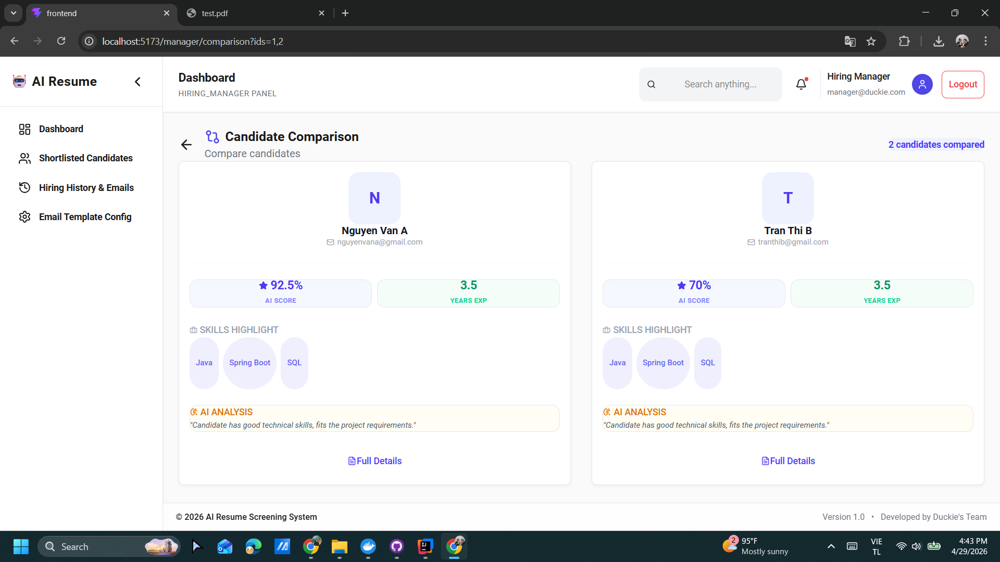
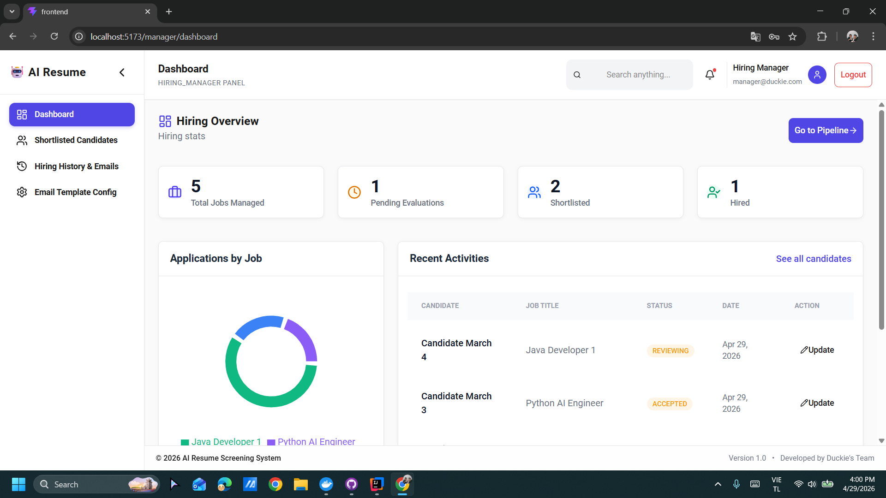
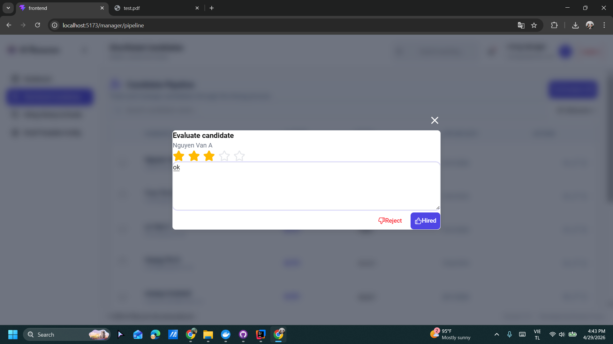

# AI Resume Screening

[Tiếng Việt](README.vi.md)

A three-person recruiting application built with React and Spring Boot. Recruiters upload résumés against a job opening. Hiring managers compare shortlisted applications, record interview feedback and decide whom to hire.

**Trịnh Thị Anh Thư** led the project and developed the Hiring Manager module across the frontend and backend. The comparison below shows the part of the workflow where a manager reads two candidates’ experience, skills and résumé analysis side by side.



## Inside the Hiring Manager module

**Find the applications that need attention.** The dashboard groups applications by job and shows pending evaluations, shortlisted candidates and recent activity. The manager opens the pipeline to filter by name or status and select candidates for comparison. [Dashboard source](frontend/src/pages/hiring-manager/Dashboard/HiringManagerDashboard.jsx) · [Dashboard integration commit](https://github.com/thuttat/AI-RESUME-SCREENING/commit/00e0230f24663cfa7d066c5b8612b822b31e0649)



**Compare the evidence and record a decision.** The comparison page reads the selected application IDs from the URL and fetches their records in parallel. From the pipeline, the manager can give a one-to-five rating, write feedback and choose a hiring outcome. The form saves the evaluation and then updates the application status through the Spring API. The scores in the screenshots come from demonstration records. [Comparison page](frontend/src/pages/hiring-manager/CandidateComparision/CandidateComparison.jsx) · [Evaluation form](frontend/src/pages/hiring-manager/CandidatePipeline/components/EvaluationForm.jsx) · [API controller](backend/src/main/java/com/duckie/backend/controller/EvaluationController.java)



## Team and scope

| Contributor | Responsibility |
| --- | --- |
| Trịnh Thị Anh Thư | Team lead and project manager. Built the Hiring Manager frontend and backend. |
| Lê Hoàng Bảo Trân | Built the Recruiter frontend and backend for job postings, résumé uploads and candidate ranking. |
| Nguyễn Triệu Duy | Built the Admin frontend and backend for users, templates and screening configuration. |

[Recruiter screens](docs/assets/recruiter) · [Admin screens](docs/assets/admin) · [Requirements](docs/requirements.md) · [Database design](docs/database-design.md) · [API documentation](docs/api-docs.md)

## Run locally

Use Docker with the Compose plugin. From a terminal:

```sh
git clone https://github.com/thuttat/AI-RESUME-SCREENING.git
cd AI-RESUME-SCREENING
docker compose up --build -d
```

Open [the local app](http://localhost). On a fresh database, sign in as `manager_test` with the local demo password `123456`. Open **Shortlisted Candidates**, select two applications and choose **Compare**. The repository seeds sample records for this walkthrough.

Compose serves the React build with Nginx on port 80, forwards `/api` to Spring Boot on port 8080 and starts RabbitMQ. The development database is H2, persisted in the `h2_data` volume. MySQL is configured separately for the production profile. Live résumé processing, file storage and outbound email require the corresponding OpenAI, Cloudinary and SMTP settings.

To inspect startup, run `docker compose logs -f backend`. Stop the stack with `docker compose down`. For frontend development, keep the backend running, then run `npm ci` and `npm run dev` in `frontend/` using Node.js 22.12 or later. Vite proxies `/api` to the local backend.

[Compose configuration](docker-compose.yml) · [Sample data](backend/src/main/java/com/duckie/backend/config/DatabaseSeeder.java) · [Controller tests](backend/src/test/java/com/duckie/backend/controller)
