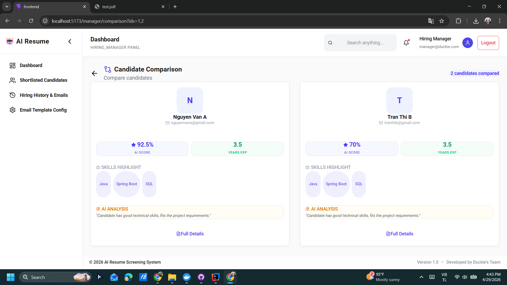
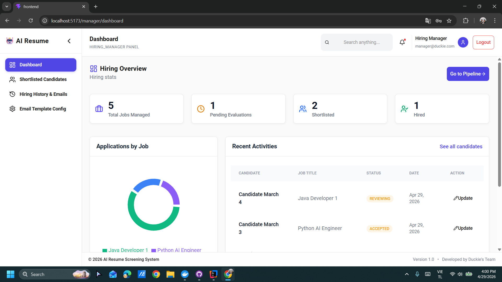
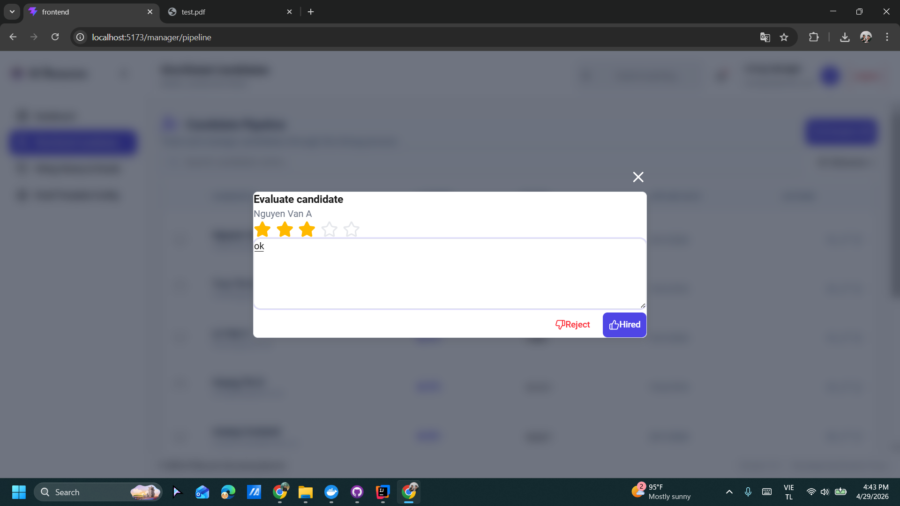

# AI Resume Screening

[English](README.md)

Ứng dụng tuyển dụng do nhóm ba người xây dựng bằng React và Spring Boot. Recruiter tiếp nhận CV theo vị trí đang tuyển. Hiring Manager xem những hồ sơ đã qua vòng sàng lọc, so sánh ứng viên, ghi nhận xét phỏng vấn và ra quyết định.

**Trịnh Thị Anh Thư** phụ trách quản lý dự án và phát triển cả frontend lẫn backend của module Hiring Manager. Trong màn hình dưới đây, người quản lý có thể đặt hai hồ sơ cạnh nhau để đối chiếu kỹ năng, kinh nghiệm và kết quả phân tích CV.



## Luồng làm việc của Hiring Manager

**Xác định hồ sơ cần xử lý.** Dashboard tổng hợp số lượt chờ đánh giá, số ứng viên vào danh sách rút gọn, phân bố hồ sơ theo vị trí và các hoạt động gần đây. Từ đó, người quản lý mở danh sách, lọc theo tên hoặc trạng thái rồi chọn ứng viên để so sánh. [Mã nguồn dashboard](frontend/src/pages/hiring-manager/Dashboard/HiringManagerDashboard.jsx) · [Commit tích hợp dashboard với API](https://github.com/thuttat/AI-RESUME-SCREENING/commit/00e0230f24663cfa7d066c5b8612b822b31e0649)



**So sánh và lưu quyết định.** Trang so sánh đọc mã hồ sơ từ URL và tải song song dữ liệu của các ứng viên đã chọn. Trong danh sách hồ sơ, người quản lý có thể chấm từ một đến năm điểm, viết nhận xét và chọn kết quả tuyển dụng. Giao diện gửi đánh giá rồi cập nhật trạng thái hồ sơ qua API Spring. Các con số trong ảnh lấy từ dữ liệu minh họa. [Trang so sánh](frontend/src/pages/hiring-manager/CandidateComparision/CandidateComparison.jsx) · [Biểu mẫu đánh giá](frontend/src/pages/hiring-manager/CandidatePipeline/components/EvaluationForm.jsx) · [Controller](backend/src/main/java/com/duckie/backend/controller/EvaluationController.java)



## Phân công

| Thành viên | Phần phụ trách |
| --- | --- |
| Trịnh Thị Anh Thư | Trưởng nhóm, quản lý dự án và phát triển frontend, backend của module Hiring Manager. |
| Lê Hoàng Bảo Trân | Phát triển module Recruiter, gồm tin tuyển dụng, tải CV và xếp hạng ứng viên. |
| Nguyễn Triệu Duy | Phát triển module Admin, gồm quản lý người dùng, biểu mẫu và cấu hình sàng lọc. |

[Ảnh module Recruiter](docs/assets/recruiter) · [Ảnh module Admin](docs/assets/admin) · [Phân tích yêu cầu](docs/requirements.md) · [Thiết kế dữ liệu](docs/database-design.md) · [Tài liệu API](docs/api-docs.md)

## Chạy trên máy cá nhân

Cài Docker có Compose, sau đó chạy:

```sh
git clone https://github.com/thuttat/AI-RESUME-SCREENING.git
cd AI-RESUME-SCREENING
docker compose up --build -d
```

Mở [ứng dụng trên máy](http://localhost). Với cơ sở dữ liệu mới, đăng nhập bằng tài khoản demo `manager_test` và mật khẩu `123456`. Mở **Shortlisted Candidates**, chọn hai hồ sơ mẫu rồi bấm **Compare**.

Compose phục vụ giao diện React qua Nginx ở cổng 80, chuyển yêu cầu `/api` đến Spring Boot ở cổng 8080 và khởi động RabbitMQ. Bản phát triển dùng H2 và lưu dữ liệu trong volume `h2_data`. Cấu hình production dùng MySQL. Để phân tích CV mới, lưu tệp hoặc gửi email thật, cần cấu hình dịch vụ tương ứng gồm OpenAI, Cloudinary và SMTP.

Xem tiến trình khởi động bằng `docker compose logs -f backend`. Dừng các dịch vụ bằng `docker compose down`. Khi phát triển frontend, giữ backend đang chạy, vào thư mục `frontend/`, dùng Node.js 22.12 trở lên rồi chạy `npm ci` và `npm run dev`. Vite chuyển các yêu cầu `/api` đến backend trên máy.

[Cấu hình Compose](docker-compose.yml) · [Dữ liệu mẫu](backend/src/main/java/com/duckie/backend/config/DatabaseSeeder.java) · [Test controller](backend/src/test/java/com/duckie/backend/controller)
